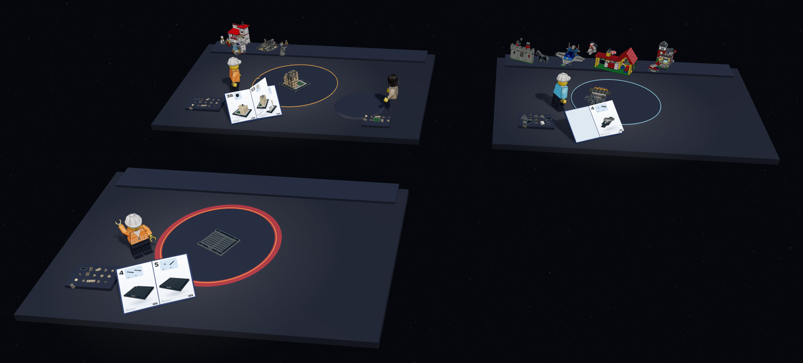

<p align="center">
  
</p>

<h1 align="center">WARDEN</h1>

<p align="center">
  <b>The agent that watches your agents.</b><br/>
  A live 3D radar for every Claude Code and Codex session on your Mac.
</p>

<p align="center">
  
  
  
  
</p>

<p align="center">
  <a href="#what-you-see">Radar</a> ·
  <a href="#brickyard">Brickyard</a> ·
  <a href="#menu-bar-and-notch">Menu bar and notch</a> ·
  <a href="#how-it-works">How it works</a> ·
  <a href="#quickstart">Quickstart</a>
</p>

---

You run Claude Code and Codex all day. A root agent here, a swarm of Explore subagents there, a Codex session in another repo. You never see the shape of it: who is working, who went idle, who is stuck waiting on you, and whose context window is about to run out.

WARDEN shows you. It tails the transcripts your agents already write and draws every session as a live globe on a 3D radar. Open it and your whole fleet is on one screen.

| | |
|---|---|
| **Local** | Reads the logs already on disk. No API keys, no account, no socket open at rest. |
| **Read-only** | Never writes to your projects. The one write outside its own database is a session title you rename from the app. |
| **Honest** | Every glow, link and count traces to a real signal. Nothing on screen is invented. |
| **Light** | Paces itself to 30 fps when it sits behind your work, and stops drawing when it is hidden. |

## What you see

- **Each agent is a globe.** Its core burns from a dim ember to white-hot as its context window fills, so a glance tells you who is running out of room.
- **Three states, not two.** A working agent blazes and breathes. An idle one sits dim. An agent **waiting on you** (a question, a plan to approve, a permission prompt) strobes red, so a blocked agent never looks like a finished one.
- **Subagents orbit their parent.** The tree mirrors the real spawn hierarchy, team members included, with their real names.
- **Colour is the harness.** Claude Code is emerald, Codex is violet. Colour always comes with a glyph and a label.
- **Rails are folders.** Agents group by project directory, so two agents in the same repo sit together.

Click a globe to fly in and open its panel: the context-window breakdown, a live feed of tool calls and messages, the files it is reading and writing, its children, model, uptime and estimated cost. **Take me there** raises the exact terminal tab the agent runs in.

## Brickyard

<p align="center">
  
</p>

Press `B`, or use the switch at the top right, to trade the radar for a workshop. Every root agent gets a bench and builds a real LEGO set from its own work.

| The agent does | On the bench |
|---|---|
| Writes a file or runs a command | The next brick from the real instructions goes on |
| A call fails | That brick comes back off |
| Updates its plan or todo list | The instruction book turns a page |
| Spawns a subagent or teammate | A new builder walks in and takes a submodel to a side table |
| Finishes a set | It goes on the shelf and the next box opens |

Click a bench for its set, brick and step counts, a 3D preview, the open instruction page and a build log where every row is a real tool call. Click a brick to see the call that placed it, the book to read it, or a shelved set to spin it on a turntable.

Sets and parts come from the [LDraw](https://www.ldraw.org) Official Model Repository and Parts Library under CC BY 2.0 / 4.0, packed into `public/brickyard/` by `scripts/brickyard/pack.mjs` so the app still needs no network. Authors are credited in [`public/brickyard/ATTRIBUTION.txt`](public/brickyard/ATTRIBUTION.txt). LEGO is a trademark of the LEGO Group, which does not sponsor or endorse this project.

## Menu bar and notch

WARDEN lives in the menu bar too. The tray opens a compact HUD with the same globes as the radar. An agent that needs you opens the panel by itself, and a click on its globe takes you straight to its terminal.

The same HUD can run inside a notch app. WARDEN serves its own bundle over a loopback bridge (`127.0.0.1`, a token minted per launch, foreign origins refused), so the notch draws the real globes, not a copy.

## How it works

```
  Claude Code / Codex transcripts
        |   file adapters: startup backfill + live FSEvents tail
        v
   canonical IR   ->   SQLite + FTS5   (byte-offset watermarks)
        |
        v
   radar recompute: liveness, awaiting, context weight, hierarchy
        |   radar_state
        v
   radar  ·  Brickyard  ·  menu-bar HUD  ·  notch bridge
```

- **Watch.** Adapters tail `~/.claude/projects/**/*.jsonl` and `~/.codex/sessions/**/rollout-*.jsonl`. Startup backfills history, then FSEvents streams new writes. Watermarks are byte offsets, so a burst of writes is never counted twice and schema drift never drops a session.
- **Normalize.** Every harness maps into one Rust intermediate representation stored in SQLite + FTS5. A new harness is one adapter file and zero downstream changes.
- **Compute.** On each change WARDEN rebuilds the live forest: which sessions are open, which wait on you, how full each context is, and who spawned whom. A one-second floor caps CPU; an agent arriving or leaving skips the queue.
- **Render.** The forest goes to the UI as a `radar_state` event and React Three Fiber draws it. The Brickyard folds each agent's tool calls into a build log on the Rust side and plays it back brick by brick.

## Quickstart

You need macOS on Apple Silicon, Rust stable 1.85 or newer, and [pnpm](https://pnpm.io).

```bash
pnpm install
pnpm tauri dev      # build and launch
pnpm tauri build    # package a macOS app
```

The window opens straight to the radar. Any Claude Code or Codex sessions on disk appear within a second or two.

### Try it in a browser

No Rust build needed. Run `pnpm dev`, then open:

| Page | What it shows |
|---|---|
| `/radar-lab.html` | The radar and detail panel against a mock forest |
| `/brickyard-lab.html` | The Brickyard with simulated agents. `?pre=300` starts 300 calls in, `?speed=4` runs faster, `?select=0` opens the first bench |
| `/war-room-lab.html` | The whole app shell, for layout checks |
| `/hud-lab.html` | The menu-bar HUD |

## Configuration

None needed. Every setting is an optional override (see [`.env.example`](.env.example)):

| Variable | Default |
|---|---|
| `WARDEN_DB_PATH` | `~/.warden/warden.db` |
| `WARDEN_CLAUDE_PROJECTS` | `~/.claude/projects` |
| `WARDEN_CODEX_SESSIONS` | `~/.codex/sessions` |

## Project layout

```
src-tauri/src/        Rust core (single crate)
  ir.rs               canonical intermediate representation
  ingest/             adapter trait, claude_code.rs, codex.rs
  store.rs            SQLite + FTS5 store
  radar/              the live forest: liveness, awaiting, hierarchy, build log
  scheduler/          live ingest and recompute drivers
  terminal.rs         "take me there": agent to terminal tab
  platform/           the macOS seam
web/viz/
  modules/radar/      constellation, globe, detail panel
  modules/brickyard/  benches, minifig rig, instruction pages
  views/war-room/     the app shell
  views/hud/          the menu-bar HUD
  shared/             state, types, theme, scene helpers
public/brickyard/     packed LDraw sets and attribution
```

Layering rules and design notes live in [`CLAUDE.md`](CLAUDE.md).

## Development

```bash
cd src-tauri && cargo test     # Rust unit and golden tests
cd src-tauri && cargo clippy   # lint (denies production unwrap)
pnpm build                     # typecheck and bundle
pnpm test                      # vitest
pnpm check:arch                # frontend import boundaries
```

Frontend imports point one way only (`app -> views -> modules -> shared`), enforced by `pnpm check:arch`. In Rust, `tauri` stays inside `lib.rs` and `commands.rs`, and OS code stays inside `platform/`.

## License

[MIT](LICENSE).
